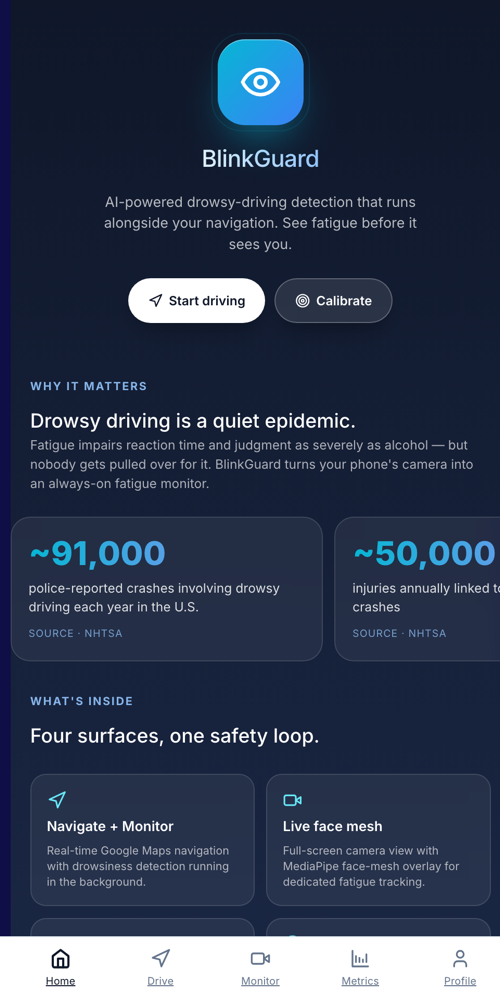

# BlinkGuard

[](https://github.com/sharonkodali/blinkguard/actions/workflows/ci.yml)



**Real-time drowsy-driving detection in the browser, with an AI safety agent that escalates alerts.**

[Live demo](https://blinkguard-one.vercel.app)

BlinkGuard watches the driver through the webcam, tracks eye and mouth landmarks with MediaPipe Face Mesh, and computes eye-aspect ratio (EAR) and mouth-aspect ratio (MAR) to detect long blinks, closed eyes, and yawns. When fatigue builds, it sounds escalating voice and siren alerts. Telemetry goes to a Fetch.ai multi-agent service that decides how hard to escalate, logs incidents, and keeps a rolling trip safety score.

## Features

- **Live monitoring** (`/monitor`): webcam EAR/MAR tracking with warning and danger thresholds
- **Calibration** (`/calibrate`): per-driver baseline so thresholds fit your eyes
- **Drive mode** (`/drive`): route planning with alerts tuned for mobile use
- **Session analytics** (`/metrics`, `/history`): warning/danger counts, EAR/MAR trends, trip score
- **Offline fallback**: if the agent service is down, the same decision logic runs in TypeScript

## Tech stack

Next.js 16, React 19, TypeScript, Tailwind · MediaPipe Face Mesh · Python + Fetch.ai uAgents · Vercel

<br clear="right">

## Run locally

```bash
npm install
npm run dev
```

Open http://localhost:3000. The app runs in mock mode until you start the agent service below.

## Fetch.ai safety agent (uAgents)

BlinkGuard's drowsiness pipeline posts telemetry to a Fetch.ai `uAgents` service that acts
as an adaptive safety coach. The orchestrator escalates alerts based on recent history,
logs incidents with severity + reasons, tracks a rolling trip safety score, and runs a
lightweight predictive fatigue model.

### Architecture

```text
/monitor (MediaPipe EAR/MAR)
   │  telemetry every 2s
   ▼
/api/safety  (Next.js bridge)
   │  HTTP POST
   ▼
SafetyOrchestratorAgent  ── ctx.send ──▶ AlertAgent, ScoringAgent
   (agents/safety_service.py, port 8100)
```

If the Python service is unreachable, `/api/safety` transparently falls back to the
TypeScript mock in [lib/safety-logic.ts](lib/safety-logic.ts) — the same decision logic
ported to TS — so the demo works offline. The HUD shows a **Mock mode** vs
**Fetch.ai live** badge so it's obvious which backend is serving each response.

### Run the Python agent service

```bash
cd agents
python -m venv .venv && source .venv/bin/activate
pip install -r requirements.txt
cp .env.example .env          # seeds + port
python safety_service.py      # starts Bureau on :8100
```

Then in a second terminal run the Next.js app:

```bash
npm run dev
```

Open `http://localhost:3000/monitor`, click **Start monitoring**, and the HUD should
flip from "Mock mode" to "Fetch.ai live" within ~2 seconds.

### Environment variables

- `SAFETY_AGENT_URL` — URL the Next.js bridge posts to. Default `http://127.0.0.1:8100/telemetry`.
- `BLINKGUARD_ORCH_SEED` / `BLINKGUARD_ALERT_SEED` / `BLINKGUARD_SCORING_SEED` — deterministic uAgents seeds.
- `BLINKGUARD_ORCH_PORT` — REST port for the orchestrator (default `8100`).

### What is real vs mocked

| Layer | Real | Mocked |
| ---- | ---- | ---- |
| MediaPipe EAR/MAR telemetry | ✅ live from webcam | — |
| uAgents orchestrator/bureau | ✅ real `Agent` + `Bureau` + `on_rest_post` | — |
| Alert / Scoring agents | ✅ real `Agent`s, fan-out via `ctx.send` | bodies are local stubs |
| Decision logic | ✅ runs inside the orchestrator | same logic ported to TS as fallback |
| Predictive fatigue | ✅ linear-regression over closed-frame window | — |

## Tests

CI runs lint, typecheck, unit tests and a production build on every push and pull request.

```bash
npm test                      # Vitest: EAR/MAR, thresholds, calibration, TS decision logic
cd agents && pip install -r requirements-dev.txt && pytest   # agent decision logic
```

- [`lib/drowsiness.test.ts`](lib/drowsiness.test.ts) builds synthetic face-mesh landmarks to check EAR/MAR math, head-pose adjustments, warning/danger frame thresholds, and calibration.
- [`lib/safety-logic.test.ts`](lib/safety-logic.test.ts) and [`agents/tests/test_logic.py`](agents/tests/test_logic.py) cover alert escalation, incident debouncing, trip score, and the linear-regression fatigue prediction.
- Both suites replay [`fixtures/safety-scenarios.json`](fixtures/safety-scenarios.json), so the TypeScript fallback and the Python agent must make the same decisions.

## Future improvements

- Move session memory from in-process to Redis / a uAgents storage backend.
- Real inter-agent messaging: have AlertAgent push to a driver's phone / SMS endpoint,
  ScoringAgent publish rolling averages to a dashboard agent.
- Add vision signals (yawn cadence, head-nod, gaze drift) as additional `SignalKind`s —
  the shared event schema already supports them.
- Train a small on-device model for the predictive head instead of the current heuristic.
